# Los Guardianes del Inti: El Derrotero Perdido

Game Design Document (GDD) · v1.1 · Noviembre 2026 · Juegos Interactivos GR1

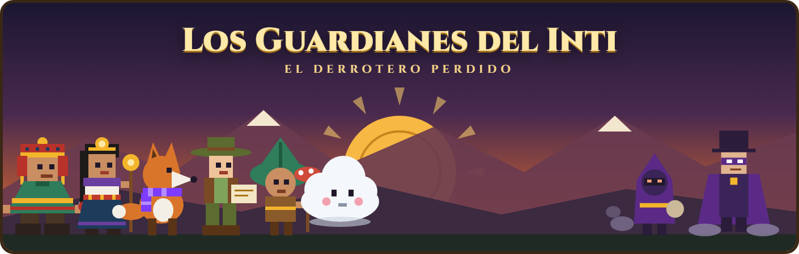

> **Jugar:** [GitHub Pages](https://2026b-sof-jueg-gr1.github.io/rocha-rocha-evelin-ximena-jueg-gr1/taller3/) ·
> [itch.io](https://everocha11.itch.io/los-guardianes-del-inti) ·
> Narrativa extendida: [NARRATIVA.md](./NARRATIVA.md)
>
> Todos los valores numéricos (velocidades, tiempos, posiciones) son los que usa
> el código del prototipo en `taller3/src/`. Todo lo marcado como *Must* y
> *Should have* está implementado y publicado.

---


## 1. Portada y ficha técnica (High Concept)

| Campo | Detalle |
|---|---|
| **Título** | Los Guardianes del Inti: El Derrotero Perdido |
| **Integrante y roles** | Evelin Ximena Rocha Rocha: dirección, diseño de juego y niveles, narrativa, programación, arte por código, audio, web y CI/CD (trabajo individual) |
| **Género** | Plataformas 2D de recolección contrarreloj, con mapa de mundo y progresión por capítulos |
| **Plataforma** | Navegador web (HTML5): escritorio y móvil. Publicado en GitHub Pages e itch.io |
| **Controles** | Teclado (A/D o flechas, W/↑/Espacio, Esc/P, M, Enter), ratón en los menús y botones táctiles en pantallas táctiles |
| **Público objetivo** | 8 a 14 años (clasificación creativa equivalente a E / PEGI 3); también docentes que busquen material sobre el Ecuador |
| **Estilo visual** | 2D vectorial plano dibujado con código (Phaser Graphics), paleta de atardecer andino |
| **Motor** | Phaser 3.90 (JavaScript) con Vite |
| **Duración** | 5 capítulos de 90 a 100 s cada uno; unos 15 minutos para completar la leyenda |

**Elevator pitch**

> *Los Guardianes del Inti* es un juego de plataformas 2D donde Roco, un mecánico
> quiteño, recorre un mapa del Ecuador reuniendo los fragmentos de un derrotero
> robado, cada uno con un dato real de su región, y suma aliados cuyas habilidades
> necesita para llegar a la siguiente llave antes del equinoccio.

---

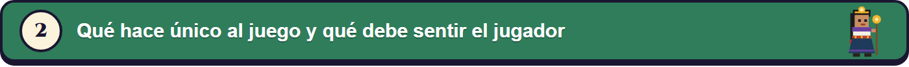

## 2. Pilares de diseño y experiencia (MDA)

### 2.1 Tres pilares (no negociables)

| # | Pilar | Qué significa en el juego | Lo que descartamos por este pilar |
|---|---|---|---|
| 1 | **Aprender es avanzar** | El conocimiento es la recompensa directa de la mecánica: cada fragmento recogido muestra un dato real (75 en total) | Preguntas tipo examen que bloqueen el avance |
| 2 | **Un equipo que crece** | Cada región suma un aliado con una habilidad jugable que se acumula con las anteriores | Mejoras compradas o aleatorias sin relación con la historia |
| 3 | **Carrera contra el sol** | Cada capítulo es una carrera contra el reloj del equinoccio, sin violencia: se gana llegando primero, no derrotando a nadie | Combate y daño a enemigos |

### 2.2 Análisis MDA

| Capa | Contenido |
|---|---|
| **Mecánicas** | Correr, salto con margen, salto doble, recoger fragmentos, flecha de la Vara del Inti, piedras ocultas, hongos-trampolín, niebla que se disipa, agentes que roban tiempo, estrellas por tiempo sobrante |
| **Dinámicas** | El jugador planea la ruta para ahorrar segundos, decide si saltar a un agente o esperar a que se aleje, combina salto doble y hongo para llegar a lo más alto, y repite capítulos para sacar ★★★ |
| **Estéticas** | **Descubrimiento** (principal: un mapa que se abre y 75 datos), **desafío** (cronómetro que se pone rojo y música que acelera), **fantasía** (ser guardián del patrimonio) y **compañerismo** (el aliado acompaña a Roco; el giro de Cuenca quita a Alba del equipo) |

---

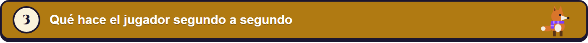

## 3. Core loop y mecánicas

### 3.1 Diagrama del core loop

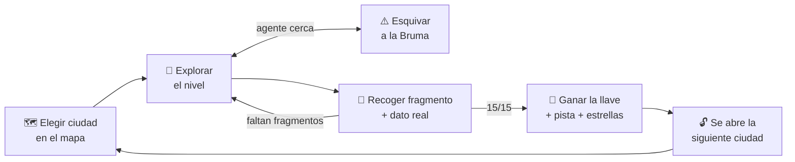

- **Segundo a segundo (2–4 s):** ver un fragmento, correr, saltar o usar la habilidad del aliado, esquivar a un agente y tocar el fragmento.
- **Minuto a minuto (90–100 s):** completar los 15 fragmentos antes del equinoccio y leer los datos.
- **Sesión:** avanzar por el mapa, desbloquear aliados, mejorar estrellas y llenar la galería de datos.

### 3.2 Tabla de mecánicas principales

| Mecánica | Input | Regla (valores reales) | Feedback al jugador |
|---|---|---|---|
| **Correr** | A/D, ←/→ o ◀ ▶ | 220 px/s; la cámara sigue a Roco con suavizado 0.08 en un mundo de 2400 × 600 px | Roco gira y se balancea al caminar; el aliado lo sigue |
| **Saltar** | W, ↑, Espacio o ▲ | Impulso de 720 px/s con gravedad 900 (≈ 288 px). Permite saltar hasta 140 ms después de dejar un borde y recuerda la pulsación 140 ms antes de tocar el suelo | Barrido de sonido ascendente |
| **Salto doble** (Brin, cap. 1+) | Saltar en el aire | Un salto extra de 620 px/s (+≈ 213 px); se recarga al tocar el suelo | Segundo tono más agudo; aparece en la línea "Equipo" del HUD |
| **Recoger fragmento** | Tocarlo | Al superponerse con el cuerpo de Roco (44 × 56 px) suma 1/15 | Campanilla y panel con el dato real durante 4 s |
| **Vara del Inti** (Alba, caps. 0–2) | Automática | Si el fragmento más cercano está a más de 80 px, una flecha dorada lo señala; los fragmentos laten (escala 1 a 1.15) | Flecha alrededor de Roco y brillo |
| **Leer símbolos** (Lino, cap. 2+) | Acercarse | Las piedras con chakana son sólidas pero casi invisibles (12 %) hasta que Roco está a menos de 230 px | Fundido de 450 ms y tono suave |
| **Hongo-trampolín** (Milo, cap. 3+) | Caer encima | Rebote de 1050 px/s (≈ 612 px); reinicia el salto doble | "Boing" y el hongo se aplasta |
| **Niebla de Nuba** (cap. 4) | Acercarse | La opacidad de la niebla baja de 0.88 a 0.04 según la distancia a Roco (110–350 px) | La niebla se abre alrededor del equipo |
| **Esquivar a la Bruma** | Saltar o esperar | Si un agente toca a Roco: +5 s al reloj consumido y 1.5 s de invulnerabilidad. No se le puede derrotar | Sacudida de cámara, humo morado 1 s, Roco parpadea y aparece un aviso |
| **Pausa** | Esc, P o botón II | Congela el nivel y su reloj (un acumulador que solo avanza en el bucle del nivel) | Menú Continuar / Reintentar / Volver al mapa |
| **Sonido** | M o botón ♪ | Activa o silencia la música y los efectos; la preferencia se recuerda | El icono cambia entre ♪ y ✕ |

### 3.3 Condiciones de victoria y derrota

| | Condición | Qué ocurre |
|---|---|---|
| **Victoria de capítulo** | Recoger los 15 fragmentos antes de que el reloj llegue a 0 | Llave, pista grabada y 1 a 3 estrellas. Se guarda el progreso y se abre la siguiente ciudad |
| **Estrellas** | Tiempo sobrante ≥ 45 % → ★★★, ≥ 20 % → ★★, si no → ★ | Se guarda la mejor marca de cada capítulo |
| **Derrota** | El reloj llega a 0 | Pantalla "¡La Bruma escapó!" con los fragmentos reunidos. Se reintenta el capítulo; el progreso anterior no se pierde |
| **Victoria final** | Completar los Llanganates | Escena final con todo el equipo: "Ahora todos son Guardianes del Inti" |

No hay vidas ni caídas mortales: el único recurso que se pierde es el **tiempo**,
y los agentes de la Bruma son la forma de perderlo. Así se respetan el pilar 3 y
el público infantil.

---


## 4. Narrativa, mundo y personajes

### 4.1 Premisa y contexto

En 1533 los conquistadores ejecutaron a Atahualpa y, según la leyenda, el general
Rumiñahui escondió en las montañas de los Llanganates el oro que aún iba en camino.
Décadas después, un español llamado Valverde dejó un *derrotero* hacia el tesoro
que nadie ha logrado seguir. En el juego, ese derrotero estaba incompleto a
propósito: el camino verdadero se grabó en un **Disco Solar** partido en cuatro
llaves, escondidas en tradiciones de cuatro regiones del Ecuador actual.

El **Rey Brumario** (Augusto Valverde, descendiente del autor del derrotero y
traficante de antigüedades) sabe que las llaves existen pero no dónde están, así
que su banda, **la Bruma**, roba entre humo las reliquias de cada región. Roco y
Alba tienen hasta el **equinoccio**, cuando el disco revela el camino bajo el sol
de la Mitad del Mundo.

### 4.2 Personajes

| | | | | | | |
|:---:|:---:|:---:|:---:|:---:|:---:|:---:|
| 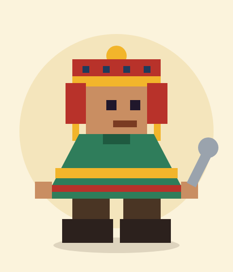 | 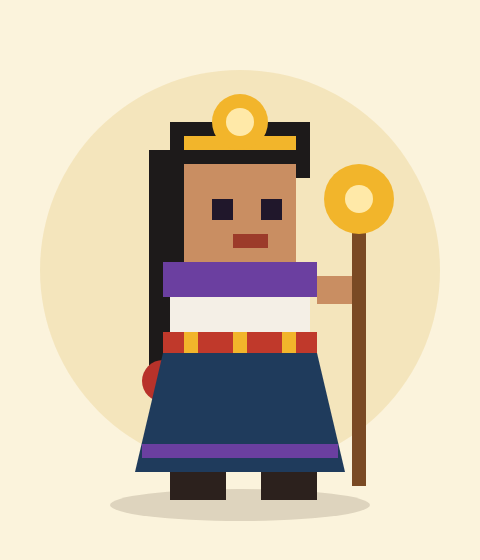 | 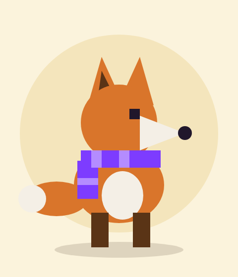 | 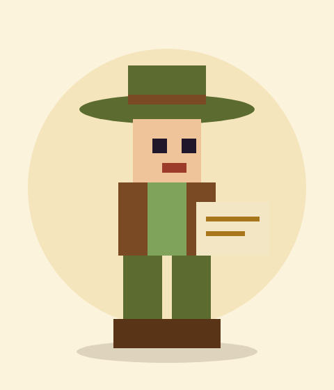 | 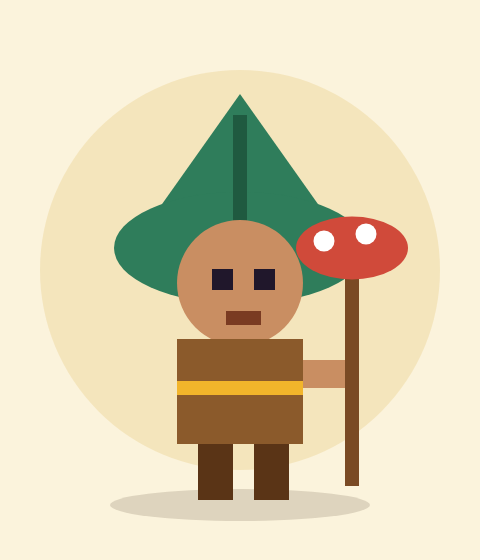 |  |  |
| **Roco** | **Alba** | **Brin** | **Lino** | **Milo** | **Nuba** | **Brumario** |

*Retratos generados con el mismo código que dibuja a los personajes dentro del juego.*

| Entidad | Rol | Motivación | Comportamiento en el juego |
|---|---|---|---|
| **Roco** | Protagonista, mecánico quiteño con chullo y poncho | Vio el robo en el museo donde trabaja | Corre, salta y recoge fragmentos; hereda las habilidades del equipo |
| **Alba** | Aliada (caps. 0–2), ñusta y última guardiana | Proteger el secreto de su linaje | Sigue a Roco a 46 px; activa la Vara del Inti. Es secuestrada al final de Cuenca y se rescata en el final |
| **Brin** | Aliado (cap. 1+), zorro del páramo | La Bruma cruzó su territorio | Concede el salto doble |
| **Lino** | Aliado (cap. 2+), cartógrafo | Le robaron la piedra que estudiaba | Revela las piedras ocultas |
| **Milo** | Aliado (cap. 3+), guardián del bosque | La Bruma usa los ríos de su selva | Hace aparecer hongos-trampolín |
| **Nuba** | Aliada (cap. 4), espíritu de las nubes | Lleva 500 años escondiendo el tesoro | Flota sobre Roco y disipa la niebla a su alrededor |
| **Rey Brumario** | Antagonista | Limpiar el nombre de su familia y vender el oro | Aparece en el mapa junto a los Llanganates tras el giro y en la pantalla del giro |
| **Agente de la Bruma** | Enemigo (caps. 1–4: 1, 2, 2 y 2 agentes) | Retrasar al equipo para que Brumario llegue antes | Patrulla un tramo de suelo de lado a lado a 80 px/s y da la vuelta en cada extremo. Si toca a Roco le roba 5 s y suelta humo que tapa la visión 1 s; después Roco es invulnerable 1.5 s. Solo se le puede saltar o esperar |
| **Reloj del equinoccio** | Amenaza principal | — | Cuenta atrás de 90 a 100 s; pasa a rojo y la música acelera ×1.3 en los últimos 15 s |
| **La niebla** | Obstáculo (cap. 4) | — | Oculta fragmentos, plataformas y agentes hasta que Roco se acerca |

---


## 5. Diseño de niveles y progresión

### 5.1 Estructura de niveles

| Cap. | Ciudad (región) | Objetivo narrativo | Mecánica nueva | Tiempo |
|---|---|---|---|---|
| 0 | **Quito** (Sierra norte) | Recuperar la máscara solar | Correr, saltar y Vara del Inti (tutorial, sin agentes) | 90 s |
| 1 | **Latacunga** (páramo del Cotopaxi) | Recuperar el adorno de la Mama Negra | Salto doble (plataformas a 290 px del suelo) + primer agente | 90 s |
| 2 | **Cuenca** (Pumapungo) | Recuperar la piedra cañari | Piedras ocultas + 2 agentes. **Giro:** se pierde a Alba | 95 s |
| 3 | **Tena** (Amazonía) | Rescatar las reliquias del río | Hongos-trampolín, sin la flecha de Alba, 2 agentes | 95 s |
| ★ | **Mitad del Mundo → Llanganates** | Rescatar a Alba y proteger el tesoro | Niebla y nubes-plataforma, 2 agentes ocultos en la niebla | 100 s |

Los capítulos se desbloquean en orden porque **la pista grabada en cada llave
señala la siguiente ciudad** ("Busca a la reina que baila de negro" lleva a la
Mama Negra de Latacunga).

### 5.2 Curva de dificultad

| Capítulo | Reto nuevo | Altura máxima | Agentes | Ayuda |
|---|---|---|---|---|
| Quito | Tutorial: correr, saltar, recoger | 204 px | 0 | Vara del Inti |
| Latacunga | Salto doble | 320 px | 1 | Vara del Inti |
| Cuenca | Piedras invisibles | 260 px | 2 | Vara del Inti (se pierde al final) |
| Tena | Hongos-trampolín | 360 px | 2 | **Sin Vara** |
| Llanganates | Niebla + nubes | 330 px | 2 | Sin Vara, niebla que oculta |

La dificultad sube por tres vías: plataformas más altas, más agentes que roban
tiempo y la pérdida de ayuda tras el giro, compensada con mecánicas nuevas.

### 5.3 Boceto del nivel: Capítulo 3, Tena

Dibujado a escala a partir de las posiciones reales del nivel (`niveles.js`).

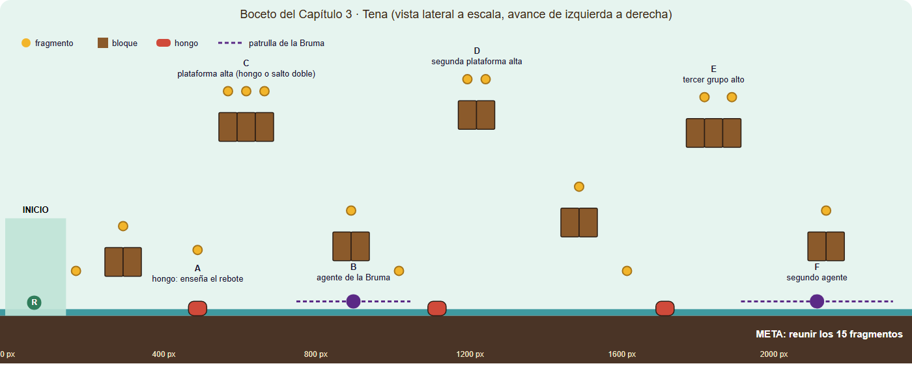

| Marca | Elemento | Función |
|---|---|---|
| **R / INICIO** | Roco (x = 90) con Milo | Zona segura sin agentes cerca |
| **A** | Primer hongo (x = 520) | Enseña el rebote: un fragmento flota justo encima |
| **B** | Agente de la Bruma (780–1080 px) | Primera amenaza: se salta o se espera |
| **C** | Plataforma alta (≈ 340 px) | Solo alcanzable con hongo o salto doble |
| **D** | Segunda plataforma alta (x ≈ 1250) | Repite el patrón hongo → plataforma |
| **E** | Tercer grupo alto (x ≈ 1880) | Último reto vertical |
| **F** | Segundo agente (1950–2350 px) | Presión al final del recorrido |
| **META** | 15/15 fragmentos | El nivel termina al reunirlos todos, estén donde estén |

### 5.4 Mapa del mundo

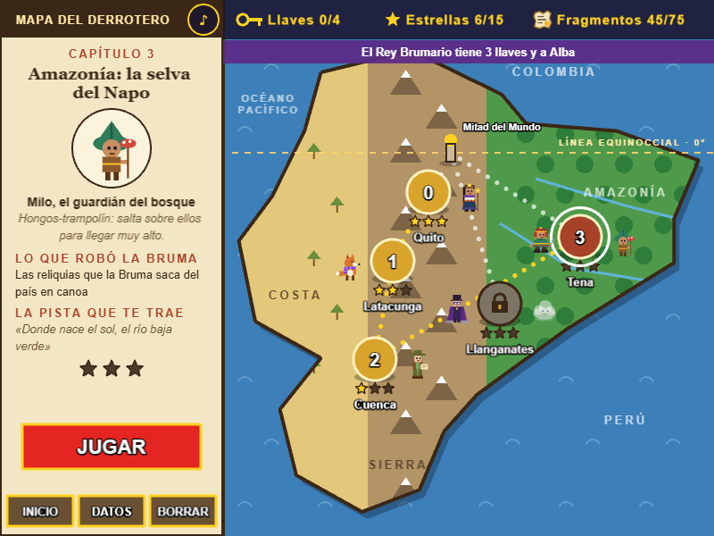

El mapa dibuja el Ecuador continental con la Costa, la Sierra, la Amazonía y la
línea equinoccial. La ruta punteada se pinta de dorado al avanzar; cada nodo
muestra un candado o el número del capítulo, las estrellas y el aliado de esa
ciudad. Tras el giro de Cuenca, el Rey Brumario espera junto a los Llanganates.

---


## 6. Dirección de arte, audio y UI/UX

### 6.1 Arte

**Estilo:** 2D vectorial plano, todo dibujado con código (no hay imágenes externas
en el juego). Formas geométricas simples, colores de atardecer andino e identidad
cultural visible: chullo y poncho (Roco), anaco, chumbi y diadema solar (Alba),
chakana en las piedras de Cuenca, volcanes, páramo, selva y niebla.

**Lenguaje visual (cómo leer la pantalla)**

| Qué se ve | Qué significa | Qué hace el jugador |
|---|---|---|
| Pergamino rasgado con sello dorado | Fragmento del derrotero | Tocarlo para recogerlo |
| Figura encapuchada morada con estela de humo | Agente de la Bruma | Saltarlo o esperar |
| Piedra gris con cruz dorada (chakana) | Plataforma oculta de Lino | Acercarse para revelarla y pisarla |
| Hongo rojo con puntos blancos | Trampolín de Milo | Caer encima para rebotar |
| Flecha dorada junto a Roco | Vara del Inti | Seguirla hasta el fragmento |
| Reloj con fondo rojo | Quedan 15 s o menos | Apurarse |

**Hoja de arte del juego**

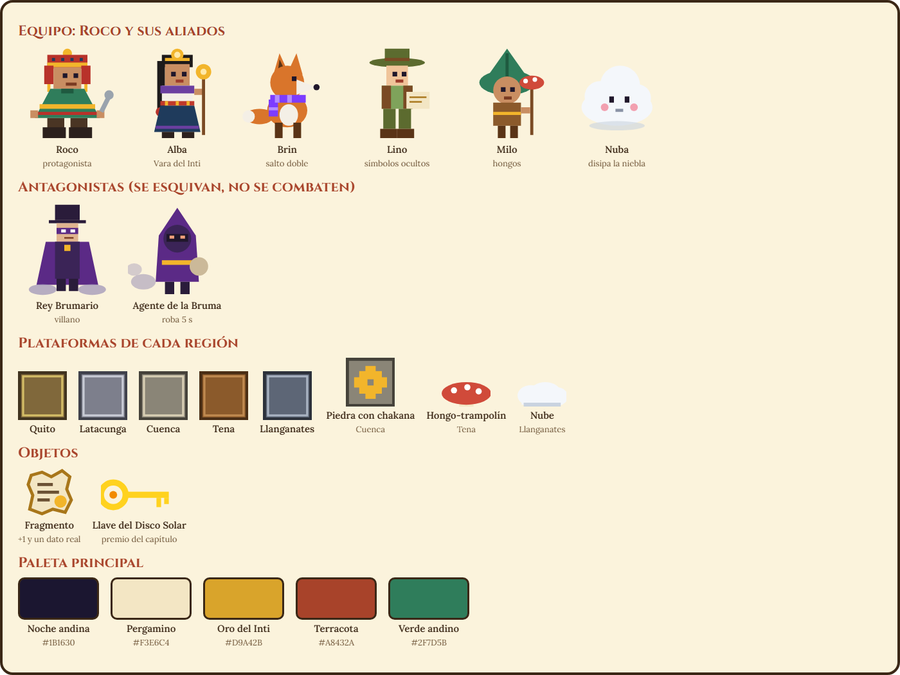

**Paleta principal**

| Color | Hex | Uso |
|---|---|---|
| Noche andina | `#1B1630` | Fondos de menús y pantallas de resultado |
| Pergamino | `#F3E6C4` | Paneles, fragmentos y texto sobre fondo oscuro |
| Oro del Inti | `#D9A42B` | Llaves, estrellas, bordes y acentos |
| Terracota | `#A8432A` | Nodos del mapa, etiquetas y botones secundarios |
| Verde andino | `#2F7D5B` | Poncho de Roco, vegetación y Amazonía |

**Moodboard por región**

| Quito (Sierra norte) | Latacunga (páramo) |
|:---:|:---:|
| 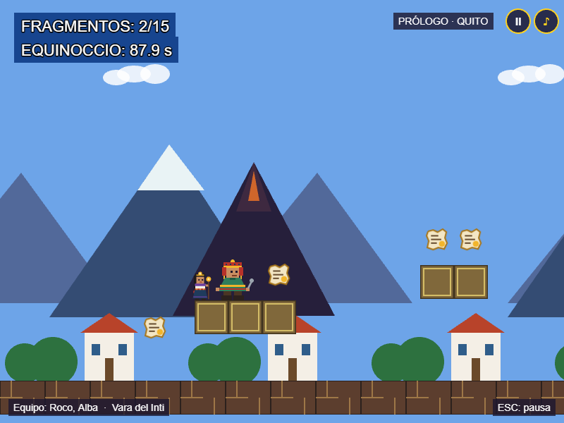 | 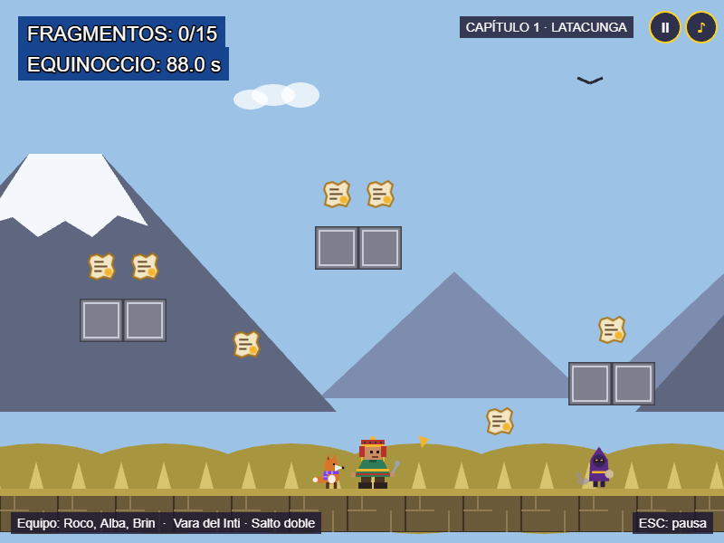 |
| Volcanes, casas coloniales blancas con tejas rojas | El Cotopaxi nevado, pajonal dorado y cóndores |
| **Cuenca (Pumapungo)** | **Tena (Amazonía)** |
| 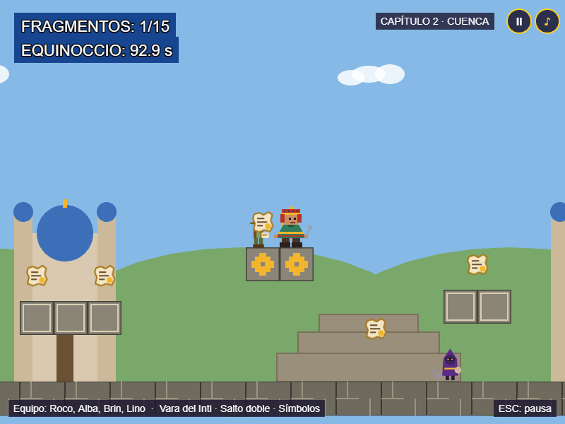 | 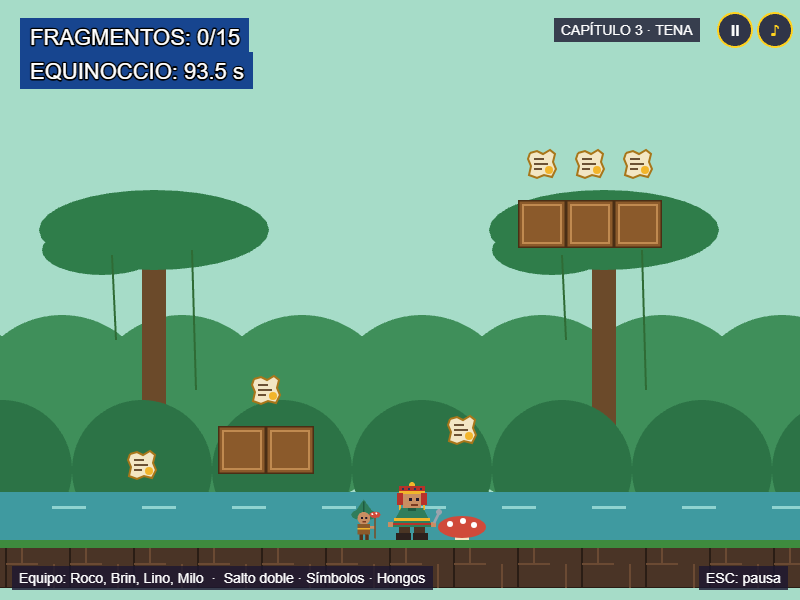 |
| Catedral de cúpulas azules y terrazas incas | Ceibas con lianas y el río Napo |
| **Llanganates** | **Mapa del mundo** |
| 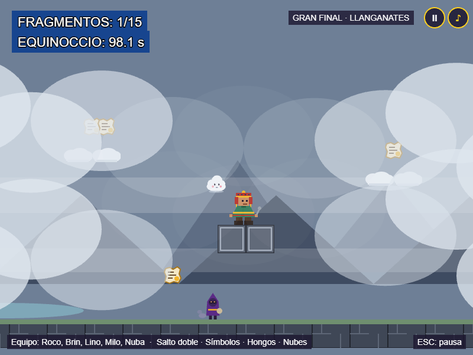 |  |
| Cerros grises, lagunas y niebla permanente | Ecuador ilustrado con sus tres regiones |

**Otras referencias de diseño**

| Referencia | Qué se toma de ella |
|---|---|
| Mapas de niveles de juegos móviles (por ejemplo, *King of Thieves*) | Camino de nodos con candados, estrellas y un personaje en cada parada |
| Textiles andinos y fajas *chumbi* | Franjas de color del poncho, el anaco y los paneles |
| "Avenida de los Volcanes" | Siluetas de volcanes en los fondos de la Sierra |
| Mapas ilustrados de viaje | Vista del Ecuador con regiones coloreadas y la línea equinoccial |

### 6.2 Audio

Todo el audio se **sintetiza en el navegador con Web Audio** (`taller3/src/audio.js`):
no hay archivos ni licencias de terceros. La música usa la escala pentatónica
andina (La menor), y la preferencia de silencio se recuerda entre partidas.

| Tipo | Momento | Descripción |
|---|---|---|
| **BGM** | Mapa | Melodía tranquila de quena (seno con vibrato) y bajo, 84 BPM, en bucle |
| **BGM** | Niveles | Versión rítmica a 112 BPM con bombo andino en cada pulso; **acelera ×1.3 en los últimos 15 s** |
| **SFX** | Salto / salto doble | Barrido ascendente corto / un segundo barrido más agudo |
| **SFX** | Fragmento | Campanilla de dos notas |
| **SFX** | Rebote en hongo | "Boing" grave ascendente |
| **SFX** | Piedra revelada | Tono suave ascendente |
| **SFX** | Golpe de la Bruma | Ráfaga de ruido con tono descendente |
| **SFX** | Llave / victoria | Arpegio pentatónico y acorde final |
| **SFX** | Derrota | Viento que se aleja ("la Bruma escapa") |
| **SFX** | Botones | Clic de madera corto |

### 6.3 UI / HUD

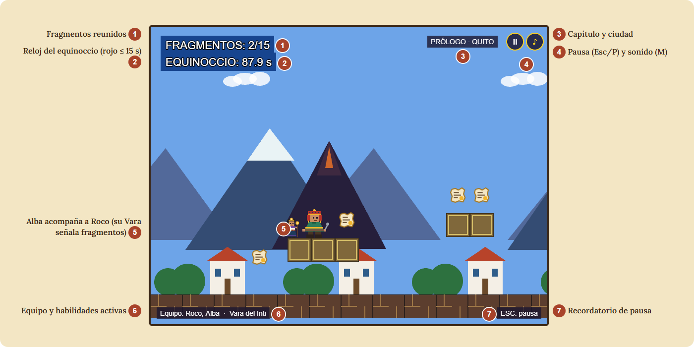

| # | Elemento | Dato mostrado |
|---|---|---|
| 1 | Fragmentos | Reunidos / 15 |
| 2 | Reloj del equinoccio | Segundos restantes (fondo rojo ≤ 15 s) |
| 3 | Capítulo | Etiqueta y ciudad |
| 4 | Botones II y ♪ | Pausa y sonido |
| 5 | Aliado | Compañero del capítulo (Alba, Brin, Lino, Milo o Nuba) |
| 6 | Equipo | Integrantes y habilidades activas |
| 7 | Ayuda | Recordatorio de la tecla de pausa |

En dispositivos táctiles aparecen además los botones ◀ ▶ (abajo a la izquierda)
y ▲ (abajo a la derecha).

**Flujo de menús**

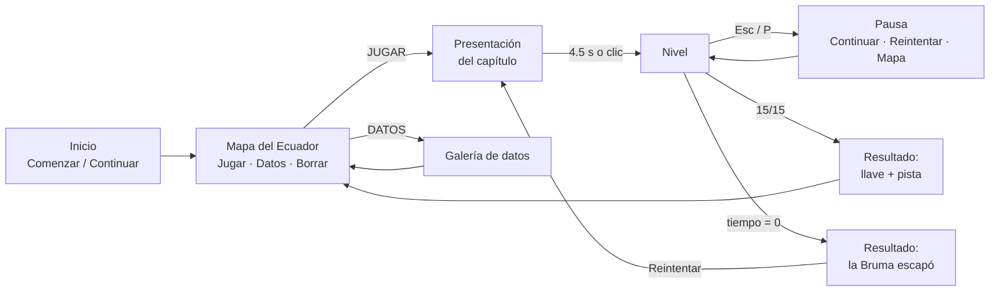

**Capturas del prototipo**

| Inicio | Presentación del capítulo |
|:---:|:---:|
| 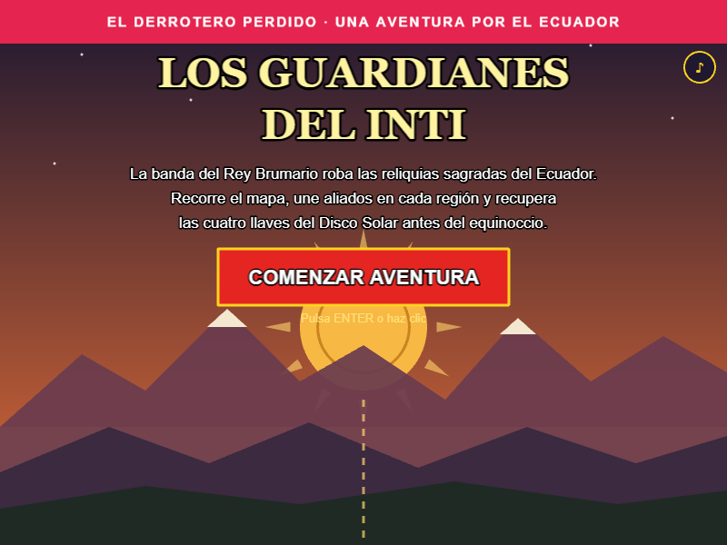 | 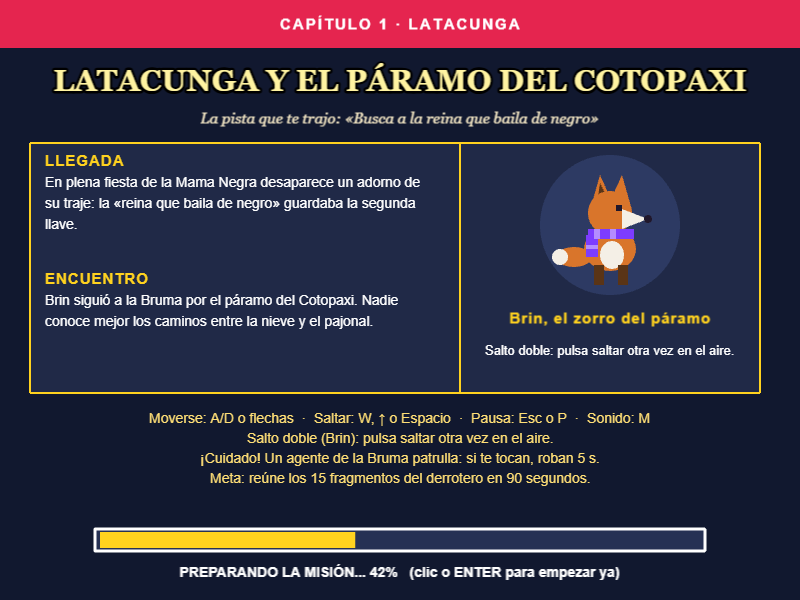 |
| **Pausa** | **Galería de datos** |
| 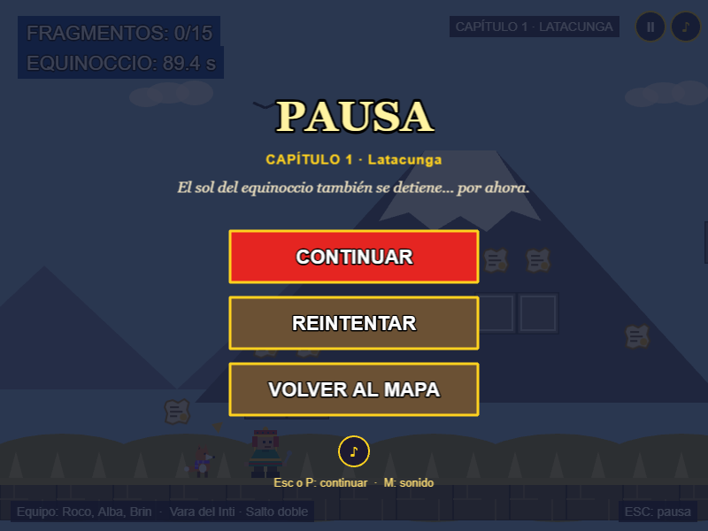 | 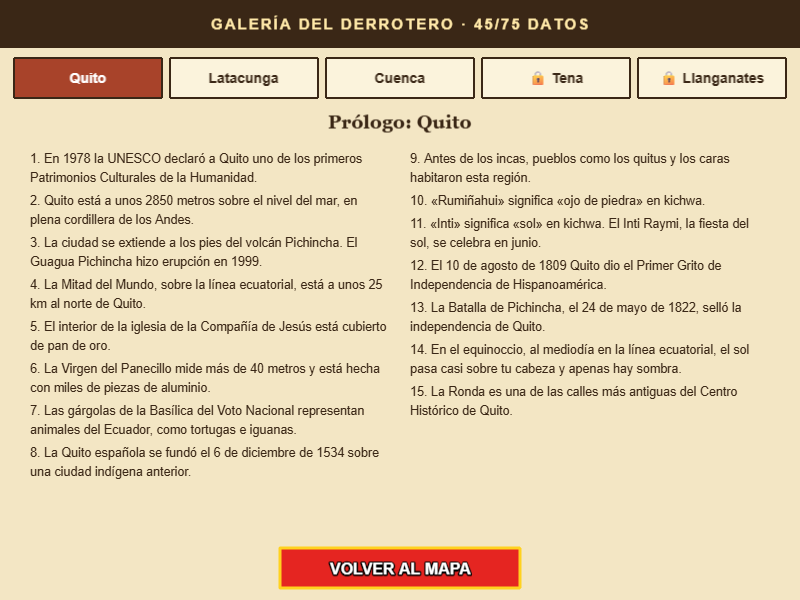 |
| **Giro de Cuenca** | **Final** |
| 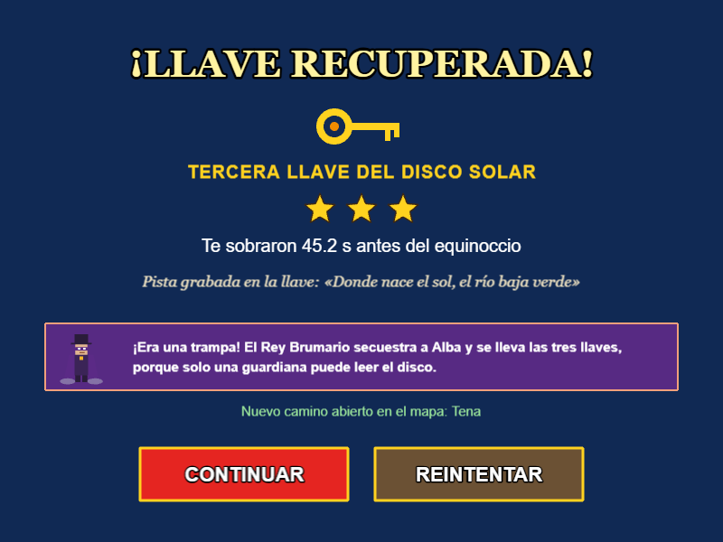 | 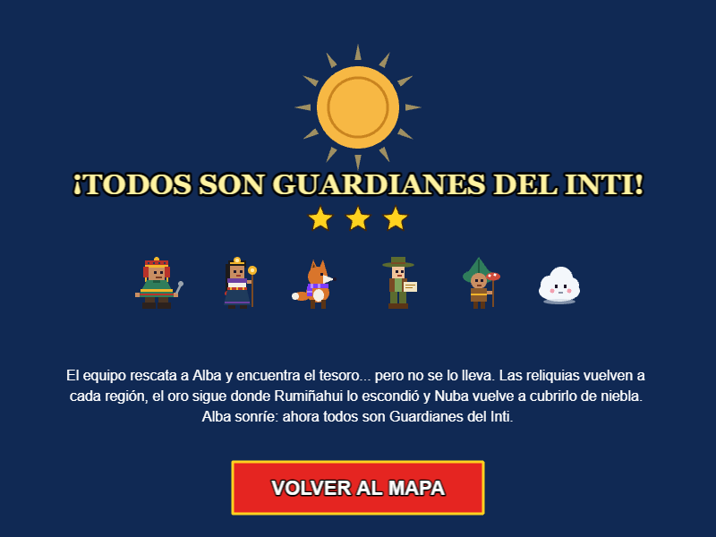 |

---


## 7. Alcance técnico y plan de producción (MVP)

### 7.1 Motor y herramientas

| Área | Herramienta |
|---|---|
| Motor | **Phaser 3.90** (físicas Arcade), JavaScript con módulos ES |
| Build | **Vite 6** (dos builds: web completa y versión para itch.io) |
| Código | Visual Studio Code |
| Arte | Phaser Graphics (dibujo por código). Los retratos de la landing y las imágenes de este documento se renderizan con los mismos dibujos del juego |
| Audio | Web Audio API: síntesis propia de música y efectos |
| Repositorio | GitHub: `2026B-sof-jueg-gr1/rocha-rocha-evelin-ximena-jueg-gr1` |
| CI/CD | GitHub Actions → GitHub Pages + itch.io con Butler en cada push a `main` |

**Estructura del repositorio**

```text
├── GDD.md                     Este documento (entrega del examen)
├── NARRATIVA.md               Historia completa y trazabilidad leyenda → juego
├── README.md                  Cómo ejecutar, construir y publicar
├── index.html                 Landing page (GitHub Pages)
├── images/personajes/         Retratos de la landing (generados por código)
├── itch-media/                Portada y capturas para itch.io
├── docs/gdd/                  Imágenes de este GDD (portada, arte, boceto, HUD, capturas)
├── taller3/
│   ├── index.html             Página del juego
│   └── src/
│       ├── main.js            Configuración de Phaser y escenas
│       ├── datos/             niveles.js (5 capítulos) y progreso.js (guardado)
│       ├── escenas/           Inicio, Mapa, Carga, Nivel, Resultado, Pausa, Galería
│       ├── audio.js           Música y efectos sintetizados
│       ├── escenarios.js      Fondos y texturas por región
│       ├── personajes.js      Personajes dibujados con código
│       └── ui.js              Estilos, botones e iconos
├── vite.config.js · vite.itch.config.js
└── .github/workflows/deploy-pages.yml   CI/CD (Pages + itch.io)
```

### 7.2 Estado actual del prototipo

| Elemento | Estado |
|---|---|
| Movimiento, salto con margen, salto doble y colisiones | ✅ Hecho |
| 5 capítulos con 15 fragmentos y un dato real por fragmento | ✅ Hecho |
| Mapa del Ecuador con desbloqueo por pistas, estrellas y progreso guardado | ✅ Hecho |
| Habilidades de los 5 aliados y giro de Cuenca | ✅ Hecho |
| Agentes de la Bruma | ✅ Hecho |
| Música y efectos, pausa, controles táctiles, galería | ✅ Hecho |
| Landing, GitHub Pages e itch.io con CI/CD | ✅ Hecho |
| Animaciones por fotogramas y tabla de récords | Pendiente (Could have) |

### 7.3 Matriz MoSCoW

| Prioridad | Elementos | Estado |
|---|---|---|
| **Must have** | Movimiento y salto con margen · 5 capítulos con 15 fragmentos y datos reales · Mapa del Ecuador con desbloqueo por pistas · Habilidades de los 5 aliados · Victoria, derrota, estrellas y progreso guardado · Landing, publicación web y CI/CD | ✅ Hecho |
| **Should have** | Música y efectos (sintetizados, obra propia) · Menú de pausa con reloj congelado · Controles táctiles · Agentes de la Bruma · Retratos propios para la landing | ✅ Hecho |
| **Could have** | Galería de los 75 datos · Balanceo al caminar | ✅ Hecho |
| | Animaciones por fotogramas · Tabla de récords por capítulo | Siguiente versión |
| **Won't have** (esta versión) | Multijugador · combate · tienda o monedas · capítulo de Galápagos · voces dobladas · versión móvil nativa | Descartado |

### 7.4 Plan de producción

| Fase | Entregable | Estado |
|---|---|---|
| 1 | Prólogo jugable (Quito) con Phaser 3 | ✅ Hecho |
| 2 | Narrativa, landing page y publicación en GitHub Pages | ✅ Hecho |
| 3 | Mapa del Ecuador, 5 capítulos y habilidades de los aliados | ✅ Hecho |
| 4 | Página en itch.io y CI/CD con Butler | ✅ Hecho |
| 5 | Agentes de la Bruma, audio, pausa, controles táctiles y galería | ✅ Hecho |
| 6 | GDD completo (este documento) | ✅ Hecho |
| 7 | Animaciones por fotogramas y tabla de récords | Siguiente versión |

### 7.5 Riesgos y mitigación

| Riesgo | Mitigación |
|---|---|
| Datos históricos incorrectos | Solo hechos verificables y bien conocidos; lo real y la ficción se separan en la landing |
| Un fragmento inalcanzable | Comprobación automática con la física real (alturas de salto por capítulo) antes de cada entrega |
| Arte con parecido a marcas existentes | Todos los personajes (juego y landing) rediseñados con identidad andina y dibujados con código; el apoyo de IA se declara en el Muro de honor |
| El navegador bloquea el audio | El sonido arranca en el primer clic o tecla, como exigen los navegadores; con M se puede silenciar |
| Pausa que no detiene el reloj | El tiempo se mide con un acumulador que solo avanza en el bucle del nivel (verificado con una prueba automática) |

*Documento vivo: se actualiza junto con el prototipo. Versión 1.1.*
