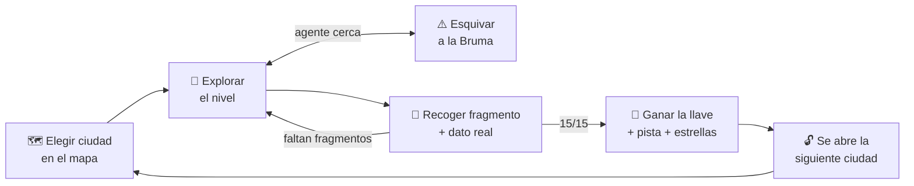
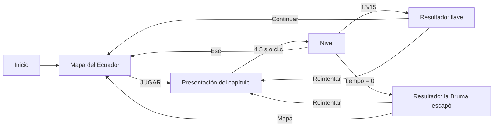
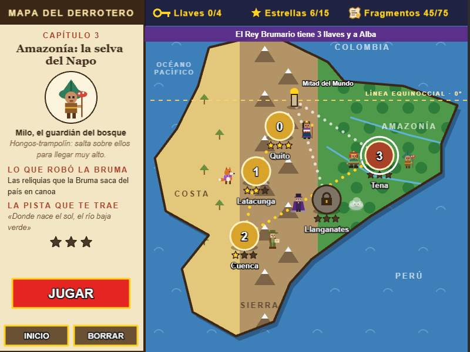
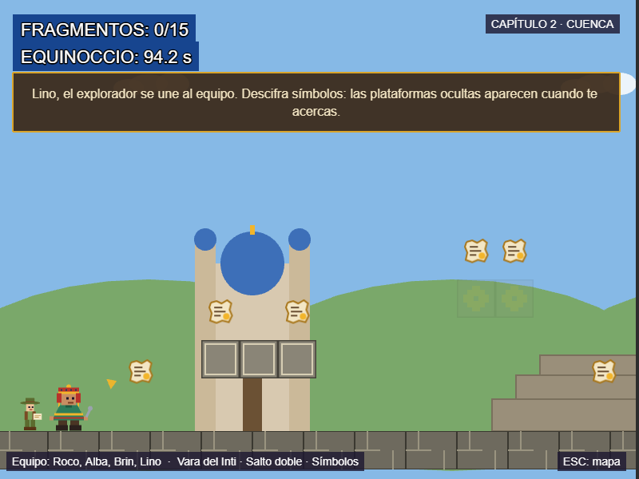
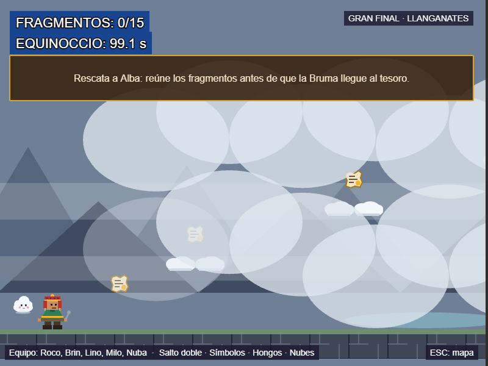

# Game Design Document · Los Guardianes del Inti: El Derrotero Perdido

> Versión 1.0 · Noviembre 2026 · Juegos Interactivos GR1
> Jugar: [GitHub Pages](https://2026b-sof-jueg-gr1.github.io/rocha-rocha-evelin-ximena-jueg-gr1/taller3/) · [itch.io](https://everocha11.itch.io/los-guardianes-del-inti) · Narrativa extendida: [NARRATIVA.md](./NARRATIVA.md)

Todos los valores numéricos de este documento (velocidades, tiempos, posiciones)
son los que usa el código del prototipo en `taller3/src/`. Todo lo descrito
como *Must* y *Should have* está implementado y publicado.

---

## 1. Portada y ficha técnica (High Concept)

| Campo | Detalle |
|---|---|
| **Título** | Los Guardianes del Inti: El Derrotero Perdido |
| **Integrante y roles** | Evelin Ximena Rocha Rocha: dirección, diseño de juego y niveles, narrativa, programación, arte por código, web y CI/CD |
| **Género** | Plataformas 2D de recolección contrarreloj, con mapa de mundo y progresión por capítulos |
| **Plataforma** | Navegador web (HTML5): escritorio y móvil. Publicado en GitHub Pages e itch.io |
| **Controles** | Teclado (A/D o flechas, W/↑/Espacio, Esc/P, M, Enter), ratón en los menús y botones táctiles en pantallas táctiles |
| **Público objetivo** | 8 a 14 años (clasificación creativa equivalente a E / PEGI 3); también docentes que busquen material sobre el Ecuador |
| **Estilo visual** | 2D vectorial plano dibujado con código (Phaser Graphics), paleta de atardecer andino |
| **Duración** | 5 capítulos de 90 a 100 s cada uno; unos 15 minutos para completar la leyenda |

**Elevator pitch**

> *Los Guardianes del Inti* es un juego de plataformas 2D donde Roco, un mecánico
> quiteño, recorre un mapa del Ecuador reuniendo los fragmentos de un derrotero
> robado, cada uno con un dato real de su región, y suma aliados cuyas habilidades
> necesita para llegar a la siguiente llave antes del equinoccio.

---

## 2. Pilares de diseño y experiencia (MDA)

### Tres pilares (no negociables)

| # | Pilar | Qué significa en el juego | Lo que descartamos por este pilar |
|---|---|---|---|
| 1 | **Aprender es avanzar** | El conocimiento es la recompensa directa de la mecánica: cada fragmento recogido muestra un dato real (75 en total) | Preguntas tipo examen que bloqueen el avance |
| 2 | **Un equipo que crece** | Cada región suma un aliado con una habilidad jugable que se acumula con las anteriores | Mejoras compradas o aleatorias sin relación con la historia |
| 3 | **Carrera contra el sol** | Cada capítulo es una carrera contra el reloj del equinoccio, sin violencia: se gana llegando primero, no derrotando a nadie | Combate y daño a enemigos |

### Estética buscada (Aesthetics)

| Estética MDA | Cómo se provoca |
|---|---|
| **Descubrimiento** (principal) | Un mapa que se va abriendo, datos culturales en cada fragmento y piedras ocultas que aparecen al acercarse |
| **Desafío** | El cronómetro, que se pone en rojo en los últimos 15 s, y las estrellas por tiempo sobrante |
| **Fantasía y narrativa** | Ser guardián del patrimonio frente a una banda de ladrones de reliquias |
| **Compañerismo** | El aliado acompaña a Roco en pantalla, y el giro de Cuenca quita a Alba del equipo |

**Dinámicas esperadas:** el jugador planea rutas para ahorrar tiempo, vuelve a
jugar para conseguir 3 estrellas y combina habilidades (salto doble más hongo para
llegar a las plataformas más altas).

---

## 3. Core loop y mecánicas

### Core loop



- **Segundo a segundo:** correr, saltar, usar la habilidad del aliado y tocar un fragmento.
- **Minuto a minuto:** completar los 15 fragmentos antes de 90 a 100 s y leer los datos.
- **Sesión:** avanzar por el mapa, desbloquear aliados y mejorar estrellas.

### Flujo de escenas



### Mecánicas principales

| Mecánica | Input | Regla (valores reales) | Feedback al jugador |
|---|---|---|---|
| **Correr** | A/D o ←/→ | 220 px/s; la cámara sigue a Roco con suavizado 0.08 en un mundo de 2400 × 600 px | El dibujo de Roco gira hacia la dirección de avance; el aliado lo sigue |
| **Saltar** | W, ↑ o Espacio | Impulso de 720 px/s con gravedad de 900 (≈ 288 px de altura). Permite saltar hasta 140 ms después de dejar un borde y recuerda la pulsación 140 ms antes de tocar el suelo | Arco de salto inmediato |
| **Salto doble** (Brin, cap. 1+) | Saltar en el aire | Un salto extra de 620 px/s (+≈ 213 px); se recarga al tocar suelo | Segundo impulso visible; aparece en la línea "Equipo" del HUD |
| **Recoger fragmento** | Tocarlo | Al superponerse con el cuerpo de Roco (44 × 56 px) desaparece y suma 1/15 | El contador sube y un panel muestra el dato real durante 4 s |
| **Vara del Inti** (Alba, caps. 0–2) | Automática | Si el fragmento más cercano está a más de 80 px, una flecha dorada lo señala; los fragmentos laten (escala 1 a 1.15) | Flecha alrededor de Roco y brillo de los fragmentos |
| **Leer símbolos** (Lino, cap. 2+) | Acercarse | Las piedras con chakana son sólidas desde el inicio pero casi invisibles (opacidad 12 %); se revelan cuando Roco está a menos de 230 px | La piedra aparece con un fundido de 450 ms |
| **Hongo-trampolín** (Milo, cap. 3+) | Caer encima | Rebote de 1050 px/s (≈ 612 px de altura); reinicia el salto doble | El hongo se aplasta y recupera su forma |
| **Niebla de Nuba** (cap. 4) | Acercarse | La niebla cubre el nivel; su opacidad baja de 0.88 a 0.04 según la distancia a Roco (entre 110 y 350 px) | La niebla se abre alrededor del equipo |
| **Esquivar a la Bruma** | Saltar o esperar | Si un agente toca a Roco: +5 s al reloj consumido y 1.5 s de invulnerabilidad. No se le puede derrotar | Sacudida de cámara, humo morado que tapa la pantalla 1 s, Roco parpadea y aparece un aviso |
| **Pausa** | Esc, P o botón II | Congela el nivel y su reloj (el tiempo se mide con un acumulador que solo avanza en el bucle del nivel) | Menú con Continuar / Reintentar / Volver al mapa |
| **Sonido** | M o botón ♪ | Activa o silencia la música y los efectos; la preferencia se recuerda | El icono cambia entre ♪ y ✕ |
| **Controles táctiles** | Botones ◀ ▶ ▲ en pantalla | Solo aparecen en dispositivos táctiles; admiten varios dedos a la vez (moverse y saltar) | Botones translúcidos con borde dorado |

### Condiciones de victoria y derrota

| Situación | Regla | Consecuencia |
|---|---|---|
| **Victoria de capítulo** | Recoger los 15 fragmentos antes de que el reloj llegue a 0 | Llave + pista grabada + 1 a 3 estrellas. Se guarda el progreso y se abre la siguiente ciudad |
| **Estrellas** | Tiempo sobrante ≥ 45 % → ★★★, ≥ 20 % → ★★, si no → ★ | Se guarda la mejor marca de cada capítulo |
| **Derrota** | El reloj llega a 0 | Pantalla "¡La Bruma escapó!" con los fragmentos reunidos. Se reintenta el capítulo desde el inicio; el progreso anterior no se pierde |
| **Victoria final** | Completar los Llanganates | Escena final con todo el equipo: "Ahora todos son Guardianes del Inti" |

No hay vidas ni caídas mortales: el único recurso que se pierde es el tiempo.
Así se respeta el pilar 3 y el público infantil.

---

## 4. Narrativa, mundo y personajes

### Premisa

En 1533 los conquistadores ejecutaron a Atahualpa y, según la leyenda, el general
Rumiñahui escondió en las montañas de los Llanganates el oro que aún iba en camino.
Décadas después, un español llamado Valverde dejó un *derrotero* hacia el tesoro
que nadie ha logrado seguir. En el juego, ese derrotero estaba incompleto a
propósito: el camino verdadero se grabó en un **Disco Solar** partido en cuatro
llaves, escondidas en tradiciones de cuatro regiones del Ecuador actual.

El **Rey Brumario** (Augusto Valverde, descendiente del autor del derrotero y
traficante de antigüedades) sabe que las llaves existen, pero no dónde están, así
que su banda, **la Bruma**, roba entre humo las reliquias de cada región. Roco y
Alba tienen hasta el **equinoccio**, cuando el disco revela el camino bajo el sol
de la Mitad del Mundo.

### Personajes y entidades jugables

| Entidad | Rol | Motivación | Comportamiento en el juego |
|---|---|---|---|
| **Roco** | Protagonista jugable, mecánico quiteño con chullo y poncho | Vio el robo en el museo donde trabaja | Corre, salta y recoge fragmentos; hereda las habilidades del equipo |
| **Alba** | Aliada (caps. 0–2), última guardiana | Proteger el secreto de su linaje | Sigue a Roco a 46 px detrás; activa la Vara del Inti. Es secuestrada al final de Cuenca y se rescata en el final |
| **Brin** | Aliado (cap. 1+), zorro del páramo | La Bruma cruzó su territorio | Concede el salto doble |
| **Lino** | Aliado (cap. 2+), cartógrafo | Le robaron la piedra que estudiaba | Revela las piedras ocultas |
| **Milo** | Aliado (cap. 3+), guardián del bosque | La Bruma usa los ríos de su selva | Hace aparecer hongos-trampolín |
| **Nuba** | Aliada (cap. 4), espíritu de las nubes | Lleva 500 años escondiendo el tesoro | Flota sobre Roco y disipa la niebla a su alrededor |
| **Rey Brumario** | Antagonista | Limpiar el nombre de su familia y vender el oro | Aparece en el mapa junto a los Llanganates tras el giro, y en la pantalla del giro |
| **El reloj del equinoccio** | Amenaza principal | — | Cuenta atrás de 90 a 100 s; pasa a rojo en los últimos 15 s; a 0 termina el capítulo |
| **La niebla** | Obstáculo (cap. 4) | — | Oculta fragmentos y plataformas hasta que Roco se acerca |
| **Agente de la Bruma** | Enemigo (caps. 1–4: 1, 2, 2 y 2 agentes) | Retrasar al equipo para que Brumario llegue antes | Patrulla un tramo de suelo de lado a lado a 80 px/s y da la vuelta en cada extremo. Si toca a Roco le roba 5 s y suelta humo que tapa la visión 1 s; después Roco es invulnerable 1.5 s. No se le puede derrotar: solo saltarlo o esperar |

---

## 5. Diseño de niveles y progresión

### Estructura

| Cap. | Ciudad (región) | Objetivo narrativo | Mecánica nueva | Tiempo |
|---|---|---|---|---|
| 0 | **Quito** (Sierra norte) | Recuperar la máscara solar | Correr, saltar y Vara del Inti (tutorial) | 90 s |
| 1 | **Latacunga** (páramo del Cotopaxi) | Recuperar el adorno de la Mama Negra | Salto doble (plataformas a 290 px del suelo) + primer agente de la Bruma | 90 s |
| 2 | **Cuenca** (Pumapungo) | Recuperar la piedra cañari | Piedras ocultas + 2 agentes. **Giro:** se pierde a Alba | 95 s |
| 3 | **Tena** (Amazonía) | Rescatar las reliquias del río | Hongos-trampolín, sin la flecha de Alba, 2 agentes | 95 s |
| ★ | **Mitad del Mundo → Llanganates** | Rescatar a Alba y proteger el tesoro | Niebla y nubes-plataforma, 2 agentes ocultos en la niebla | 100 s |

Los capítulos se desbloquean en orden porque **la pista grabada en cada llave
señala la siguiente ciudad** (por ejemplo, "Busca a la reina que baila de negro"
lleva a la Mama Negra de Latacunga).

### Curva de dificultad

```text
Dificultad
  ▲                                         ★ niebla + nubes, sin Vara, 2 agentes
  │                               ● hongos, sin Vara (pierde ayuda), 2 agentes
  │                  ● piedras invisibles, 2 agentes
  │      ● salto doble, plataformas más altas, 1 agente
  │ ● tutorial con ayuda total (Vara)
  └──────────────────────────────────────────▶ Capítulo
    Quito  Latacunga  Cuenca    Tena    Llanganates
```

La dificultad sube por tres vías: plataformas cada vez más altas (de 114 a 360 px
sobre el suelo), más agentes de la Bruma que roban tiempo, y la pérdida de ayuda
tras el giro, compensada con mecánicas nuevas.

### Boceto de nivel: Capítulo 3, Tena (greybox a escala)

Generado a partir de las posiciones reales del nivel. Cada carácter mide 40 × 32 px.

```text
                              **                              ← fragmentos a 144 px
               ***            ###             * *
              ####            ###            ####            ← plataformas altas
              ####                           ####              (solo con hongo
                                                                o salto doble)
                                      *
                       *            ####              *
        *            ####           ####             ###
      ####   *       ####                            ###
     *####                *              *

  R         TT     B<---->B TT             TT   B<------->B
============================================================  ← suelo y río Napo
0         400       800       1200      1600      2000   2400 px
```

| Símbolo | Significado |
|---|---|
| `R` | Inicio de Roco (x = 90) con Milo detrás |
| `#` | Bloque de madera (48 × 48 px) |
| `T` | Hongo-trampolín (x = 520, 1150 y 1750): rebote de ≈ 612 px |
| `*` | Fragmento del derrotero (15 en total) |
| `B<-->B` | Agente de la Bruma patrullando a 80 px/s (tramos 780–1080 y 1950–2350) |
| `=` | Suelo |
| META | El nivel termina en cuanto se reúnen los 15 fragmentos, estén donde estén |

**Lectura del nivel:** los tres grupos altos (x ≈ 600, 1250 y 1880) quedan a
340–360 px del suelo, fuera del alcance de un salto simple. Cada uno tiene un
hongo justo antes, que enseña la mecánica nueva. Los dos agentes vigilan los
tramos de suelo entre hongos, así que conviene cruzarlos por arriba. Sin la
flecha de Alba, el jugador debe mirar el escenario completo para encontrar los
fragmentos.

### Mapa del mundo

El mapa (ver `itch-media/1-mapa-del-ecuador.png`) dibuja el Ecuador continental
con la Costa, la Sierra y la Amazonía y la línea equinoccial. La ruta punteada se
pinta de dorado al avanzar; cada nodo muestra un candado o el número del capítulo,
las estrellas y el aliado de esa ciudad.

---

## 6. Dirección de arte, audio y UI/UX

### Arte

- **Estilo:** 2D vectorial plano, todo dibujado con código (sin imágenes externas en el juego). Formas geométricas simples, sin contorno, con sombras planas.
- **Identidad andina:** chullo y poncho (Roco), anaco, chumbi y diadema solar (Alba), chakana en las piedras de Cuenca, volcanes, páramo, selva y niebla.

**Paleta principal**

| Color | Hex | Uso |
|---|---|---|
| Noche andina | `#1B1630` | Fondos de menús y pantallas de resultado |
| Pergamino | `#F3E6C4` | Paneles, fragmentos y texto sobre fondo oscuro |
| Oro del Inti | `#D9A42B` | Llaves, estrellas, bordes y acentos |
| Terracota | `#A8432A` | Nodos del mapa, etiquetas y botones secundarios |
| Verde andino | `#2F7D5B` | Poncho de Roco, vegetación y Amazonía |

**Moodboard (capturas del prototipo)**

| Mapa del Ecuador | Cuenca · Pumapungo | Niebla de los Llanganates |
|---|---|---|
|  |  |  |

**Referencias de inspiración (descritas):** textiles andinos y fajas *chumbi*
(paleta y franjas), siluetas de volcanes de la "Avenida de los Volcanes" y mapas
ilustrados de viaje (vista del mapa del mundo).

### Audio

Todo el audio se **sintetiza en el navegador con Web Audio** (`taller3/src/audio.js`):
no hay archivos ni licencias de terceros. La música usa la escala pentatónica
andina (La menor), y la preferencia de silencio se recuerda entre partidas.

| Tipo | Momento | Descripción |
|---|---|---|
| **BGM** | Mapa | Melodía tranquila de quena (seno con vibrato) y bajo, 84 BPM, en bucle |
| **BGM** | Niveles | Versión rítmica a 112 BPM con bombo andino en cada pulso; **acelera ×1.3 en los últimos 15 s** |
| **SFX** | Salto / salto doble | Barrido ascendente corto / un segundo barrido más agudo |
| **SFX** | Fragmento | Campanilla de dos notas |
| **SFX** | Rebote en hongo | "Boing" grave ascendente |
| **SFX** | Piedra revelada | Tono suave ascendente |
| **SFX** | Golpe de la Bruma | Ráfaga de ruido con tono descendente |
| **SFX** | Llave / victoria | Arpegio pentatónico y acorde final |
| **SFX** | Derrota | Viento que se aleja ("la Bruma escapa") |
| **SFX** | Botones | Clic de madera corto |

### UI / HUD

```text
┌──────────────────────────────────────────────────────────────┐
│ FRAGMENTOS: 12/15                CAPÍTULO 3 · TENA  (II) (♪) │
│ EQUINOCCIO: 42.3 s   (rojo si ≤ 15 s)                        │
│ ┌──────────────────────────────────────────────────────────┐ │
│ │ 📜 Fragmento 12: Las cavernas de Jumandy recuerdan...    │ │  ← dato, 4 s
│ └──────────────────────────────────────────────────────────┘ │
│                                                              │
│            (nivel + Roco + aliado + agentes)                 │
│ (◀)(▶)                                                 (▲)   │  ← solo táctil
│ Equipo: Roco, Brin, Lino, Milo · Salto doble · Hongos  ESC: pausa │
└──────────────────────────────────────────────────────────────┘
```

| Pantalla | Qué ve el jugador |
|---|---|
| **Inicio** | Título, resumen de la historia y botón *Comenzar / Continuar aventura* |
| **Mapa** | Barra superior (llaves x/4, estrellas x/15, fragmentos x/75), panel lateral con aliado, robo, pista y botón JUGAR; botones Inicio, Datos, Borrar y sonido |
| **Galería** | Los datos de cada región, que se desbloquean al completar su capítulo, en pestañas por ciudad (tecla G o botón Datos) |
| **Presentación** | Llegada, encuentro con el aliado, controles, habilidades activas y barra de carga que se puede saltar |
| **Nivel** | HUD de arriba (sin vidas: el recurso es el tiempo) |
| **Resultado** | Llave, estrellas, tiempo sobrante, pista y botones Continuar / Reintentar / Mapa |
| **Pausa** | Con Esc, P o el botón II: Continuar / Reintentar / Volver al mapa y botón de sonido; el reloj queda congelado |

---

## 7. Alcance técnico y plan de producción (MVP)

### Motor y herramientas

| Área | Herramienta |
|---|---|
| Motor | **Phaser 3.90** (físicas Arcade), JavaScript con módulos ES |
| Build | **Vite 6** (dos builds: web completa y versión itch.io) |
| Arte | Phaser Graphics (dibujo por código). Los retratos de la landing se renderizan desde los mismos dibujos del juego |
| Audio | Web Audio API: síntesis propia de música y efectos, sin archivos externos |
| Repositorio | GitHub: `2026B-sof-jueg-gr1/rocha-rocha-evelin-ximena-jueg-gr1` |
| CI/CD | GitHub Actions → GitHub Pages + itch.io con Butler |
| Datos | Todo el contenido de los capítulos está en `taller3/src/datos/niveles.js` |

### Matriz MoSCoW

| Prioridad | Elemento | Estado |
|---|---|---|
| **Must have** | Movimiento, salto con margen y colisiones | ✅ Hecho |
| | 5 capítulos con 15 fragmentos y un dato real por fragmento | ✅ Hecho |
| | Mapa del Ecuador con desbloqueo por pistas | ✅ Hecho |
| | Habilidades de los 5 aliados | ✅ Hecho |
| | Victoria, derrota, estrellas y progreso guardado | ✅ Hecho |
| | Landing, publicación web y CI/CD | ✅ Hecho |
| **Should have** | Música y efectos (sintetizados, obra propia) | ✅ Hecho |
| | Menú de pausa con reloj congelado | ✅ Hecho |
| | Controles táctiles para móvil | ✅ Hecho |
| | Agentes de la Bruma (enemigo que roba tiempo) | ✅ Hecho |
| | Retratos propios para la landing | ✅ Hecho |
| **Could have** | Galería de los 75 datos desbloqueados | ✅ Hecho |
| | Balanceo de Roco al caminar | ✅ Hecho |
| | Animaciones por fotogramas (caminar, saltar) | Idea para la siguiente versión |
| | Tabla de récords por capítulo | Idea para la siguiente versión |
| **Won't have** (esta versión) | Multijugador, combate, tienda o monedas, capítulo de Galápagos, voces dobladas, versión móvil nativa | Descartado |

### Riesgos y mitigación

| Riesgo | Mitigación |
|---|---|
| Datos históricos incorrectos | Solo hechos verificables y bien conocidos; lo real y la ficción se separan en la landing |
| Un fragmento inalcanzable | Comprobación automática con la física real (alturas de salto por capítulo) antes de cada entrega |
| Arte con parecido a marcas existentes | Todos los personajes (juego y landing) rediseñados con identidad andina y dibujados con código; el apoyo de IA se declara en el Muro de honor |
| El navegador bloquea el audio | El sonido arranca en el primer clic o tecla, como exigen los navegadores; con M se puede silenciar |
| Pausa que no detiene el reloj | El tiempo se mide con un acumulador que solo avanza en el bucle del nivel (verificado con una prueba automática) |
